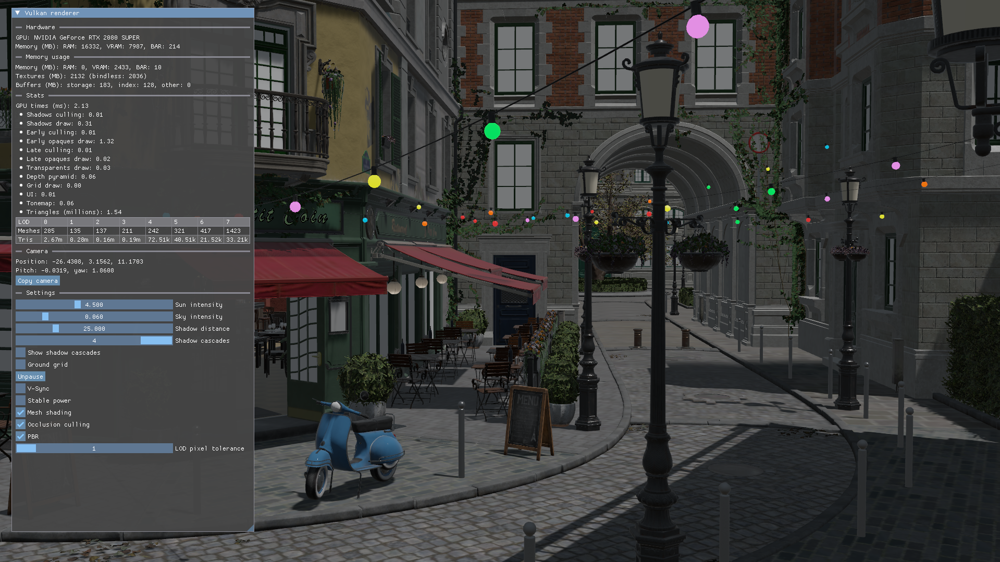
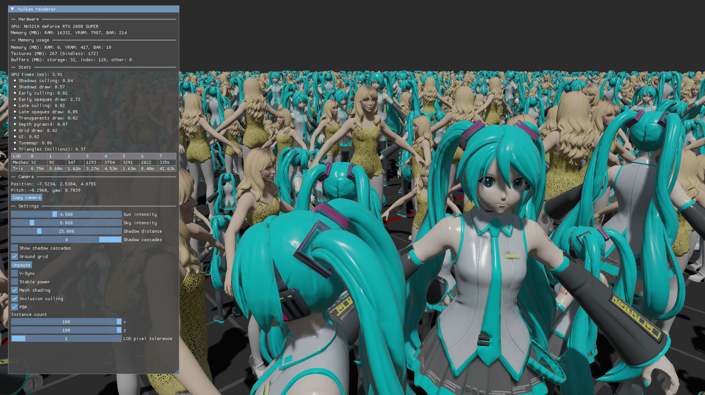

# Brutus - Adventures in Graphics Programming

A work in progress 3d renderer and companion to my blog posts and conferences talks.

## Overview

Renders GLTF scenes and individual models using modern graphics techniques as we learn them.

Use C++23 and try to optimize the startup and runtime performance as well we can.

| *Bistro scene* | *Crowd scene* |
| :---: | :---: |
|  |  |

## Features

- Forward renderer using mesh shader, with fallback to vertex shader pipelines
- PBR (metallic/roughness) and diffuse (specular glossiness) materials support
- Cascaded shadow maps (maybe ray-tracing later)
- PNG and DDS (BC) textures support
- On the fly texture compression, mips and LOD generation
- Shader live editing
- Lighting is basic (for now): directional sunlight and basic hemisphere ambient, no global illumination
- Post processing is just HDR tonemap at the moment

## Hardware requirements

Same our [vulkan abstraction](https://github.com/mropert/vk-renderer): Vulkan 1.3 compliant device.

Built & tested on Windows. Should still work on Mac but I don't have access to hardware to confirm it anymore.

## Assets

The test assets are not part of the repository and will not be committed. I recommend trying out
[this copy of Bistro](https://github.com/zeux/niagara_bistro) for a full scene, and whatever glb/gltf
asset(s) you fancy for the crowd test scene.

## Building

Easiest way is to use `vcpkg` in manifest mode to pull the dependencies.

## AI / LLM notice

I have used some LLM code assist since late Oct 2026. The commits are still all reviewed and owned by me, I do not believe
in "vibe coding". Exception: the files under `docs` and `util` are mostly made and used by AI for its test harness.

## License

Copyright (C) 2025-2026 Mathieu Ropert
Licensed under the GNU General Public License v3.0, see LICENSE.